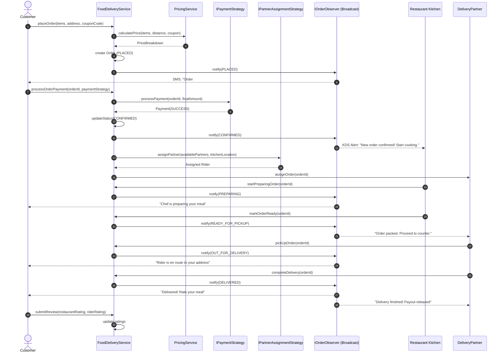

# Food Sprint - Low-Level Design (LLD)

A production-grade, object-oriented Low-Level Design (LLD) implementation of an on-demand **Food Delivery System** (similar to Swiggy, Zomato, and DoorDash) built in **C++17** applying **SOLID Principles**, modern **Design Patterns**, and clean separation of concerns.

---

## 📌 Problem Statement & Requirements

### 1. Functional Requirements
- **Restaurant & Menu Management**: Restaurants can register, manage menus with categories (Starters, Main Course, Desserts, Beverages) and dietary classifications (`VEG`, `NON_VEG`, `VEGAN`).
- **Discovery & Search**: Customers can search restaurants by name, cuisine, dietary preference, and geographic radius.
- **Cart & Order Creation**: Customers can select items, specify custom cooking instructions, and place orders.
- **Dynamic Pricing & Promotions**: Pricing engine computes item subtotals, tax (GST), distance-based delivery fees, surge pricing during bad weather or peak hours, and coupon code discounts.
- **Payment Processing**: Pluggable payment strategies (UPI, Credit/Debit Card, Digital Wallet, Cash On Delivery) with instant automated refund handling.
- **Delivery Partner Dispatch**: Algorithmic assignment of delivery riders using pluggable strategies (Nearest Proximity vs. Highest Rated).
- **Live Lifecycle Notifications**: Event-driven order status progression (`PLACED` → `CONFIRMED` → `PREPARING` → `READY_FOR_PICKUP` → `OUT_FOR_DELIVERY` → `DELIVERED` / `CANCELLED`) notifying Customer, Kitchen, and Courier in real-time.
- **Feedback & Rating**: Post-delivery rating updates for restaurants and delivery couriers.

### 2. Non-Functional Requirements
- **Extensibility**: Easy to add new payment modes, delivery fee algorithms, and notification channels without modifying existing core code (Open-Closed Principle).
- **Concurrency & Thread Safety**: In-memory repositories utilize mutex locking for thread-safe operations.
- **Clean Architecture**: Decoupled domain models, repositories, strategies, observers, and service facades.

---

## 📊 UML Diagrams

### 1. Class Diagram

```mermaid
classDiagram
    direction TB

    class Location {
        -double latitude
        -double longitude
        -string address
        +distanceTo(Location) double
        +getAddress() string
        +toString() string
    }

    class DietaryPreference {
        <<enumeration>>
        VEG
        NON_VEG
        VEGAN
    }

    class MenuItem {
        -string id
        -string name
        -string description
        -double price
        -DietaryPreference preference
        -string category
        -bool isAvailable
        +getPrice() double
        +getPreference() DietaryPreference
        +toString() string
    }

    class Restaurant {
        -string id
        -string name
        -string cuisine
        -Location location
        -vector~MenuItem~ menu
        -double rating
        -int ratingCount
        -bool isOpen
        +addMenuItem(MenuItem) void
        +getMenuItem(string) MenuItem
        +addRating(double) void
        +getItemsByPreference(DietaryPreference) vector
    }

    class User {
        -string id
        -string name
        -string email
        -string phone
        -Location defaultAddress
        -vector~Location~ savedAddresses
        +getDefaultAddress() Location
    }

    class DeliveryPartner {
        -string id
        -string name
        -string phone
        -string vehicleType
        -Location currentLocation
        -bool isAvailable
        -double rating
        -string currentOrderId
        +assignOrder(string) void
        +completeOrder() void
        +addRating(double) void
    }

    class OrderItem {
        -MenuItem menuItem
        -int quantity
        -double unitPrice
        -string specialInstructions
        +getTotalPrice() double
    }

    class OrderStatus {
        <<enumeration>>
        PLACED
        CONFIRMED
        PREPARING
        READY_FOR_PICKUP
        OUT_FOR_DELIVERY
        DELIVERED
        CANCELLED
    }

    class PriceBreakdown {
        +double itemTotal
        +double tax
        +double deliveryFee
        +double discount
        +double finalAmount
        +string couponCodeApplied
        +toString() string
    }

    class Order {
        -string id
        -string customerId
        -string restaurantId
        -string deliveryPartnerId
        -vector~OrderItem~ items
        -Location deliveryLocation
        -PriceBreakdown priceBreakdown
        -OrderStatus status
        -Payment payment
        +updateStatus(OrderStatus, string) bool
    }

    class IDeliveryFeeStrategy {
        <<interface>>
        +calculateFee(double distanceKm, double orderTotal)* double
        +getStrategyName()* string
    }
    class DistanceBasedDeliveryFeeStrategy {
        +calculateFee(double distanceKm, double orderTotal) double
    }
    class SurgeDeliveryFeeStrategy {
        +calculateFee(double distanceKm, double orderTotal) double
    }
    class FreeDeliveryAboveThresholdStrategy {
        +calculateFee(double distanceKm, double orderTotal) double
    }
    IDeliveryFeeStrategy <|.. DistanceBasedDeliveryFeeStrategy
    IDeliveryFeeStrategy <|.. SurgeDeliveryFeeStrategy
    IDeliveryFeeStrategy <|.. FreeDeliveryAboveThresholdStrategy

    class IPartnerAssignmentStrategy {
        <<interface>>
        +assignPartner(vector~DeliveryPartner~, Location)* DeliveryPartner
    }
    class NearestPartnerAssignmentStrategy {
        +assignPartner(vector~DeliveryPartner~, Location) DeliveryPartner
    }
    class HighestRatedPartnerAssignmentStrategy {
        +assignPartner(vector~DeliveryPartner~, Location) DeliveryPartner
    }
    IPartnerAssignmentStrategy <|.. NearestPartnerAssignmentStrategy
    IPartnerAssignmentStrategy <|.. HighestRatedPartnerAssignmentStrategy

    class IPaymentStrategy {
        <<interface>>
        +processPayment(string orderId, double amount)* Payment
        +refundPayment(Payment)* bool
    }
    class UpiPaymentStrategy {
        +processPayment(string, double) Payment
        +refundPayment(Payment) bool
    }
    class CreditCardPaymentStrategy {
        +processPayment(string, double) Payment
        +refundPayment(Payment) bool
    }
    class WalletPaymentStrategy {
        +processPayment(string, double) Payment
        +refundPayment(Payment) bool
    }
    class CashOnDeliveryStrategy {
        +processPayment(string, double) Payment
        +refundPayment(Payment) bool
    }
    IPaymentStrategy <|.. UpiPaymentStrategy
    IPaymentStrategy <|.. CreditCardPaymentStrategy
    IPaymentStrategy <|.. WalletPaymentStrategy
    IPaymentStrategy <|.. CashOnDeliveryStrategy

    class IOrderObserver {
        <<interface>>
        +onOrderStatusUpdated(Order, OrderStatus oldStatus, OrderStatus newStatus)* void
    }
    class CustomerNotificationObserver {
        +onOrderStatusUpdated(Order, OrderStatus, OrderStatus) void
    }
    class RestaurantNotificationObserver {
        +onOrderStatusUpdated(Order, OrderStatus, OrderStatus) void
    }
    class DeliveryPartnerNotificationObserver {
        +onOrderStatusUpdated(Order, OrderStatus, OrderStatus) void
    }
    IOrderObserver <|.. CustomerNotificationObserver
    IOrderObserver <|.. RestaurantNotificationObserver
    IOrderObserver <|.. DeliveryPartnerNotificationObserver

    class FoodDeliveryService {
        -IUserRepository userRepo
        -IRestaurantRepository restaurantRepo
        -IDeliveryPartnerRepository partnerRepo
        -IOrderRepository orderRepo
        -ICouponRepository couponRepo
        -PricingService pricingService
        -IPartnerAssignmentStrategy partnerAssignmentStrategy
        -vector~IOrderObserver~ observers
        +placeOrder(...) Order
        +processOrderPayment(...) bool
        +assignDeliveryPartner(...) bool
        +startPreparingOrder(...) bool
        +markOrderReady(...) bool
        +pickUpOrder(...) bool
        +completeDelivery(...) bool
        +cancelOrder(...) bool
        +submitReview(...) bool
    }

    Restaurant *-- MenuItem
    Restaurant *-- Location
    User *-- Location
    DeliveryPartner *-- Location
    Order *-- OrderItem
    Order *-- PriceBreakdown
    Order *-- OrderStatus
    OrderItem o-- MenuItem
    FoodDeliveryService o-- IOrderObserver
    FoodDeliveryService o-- IPartnerAssignmentStrategy
    FoodDeliveryService o-- IDeliveryFeeStrategy
```



---

### 2. Sequence Diagram (Order Lifecycle & Real-time Notifications)



---

## 🧩 Design Patterns Applied

| Pattern | Component | Purpose |
| :--- | :--- | :--- |
| **Strategy Pattern** | `IDeliveryFeeStrategy` | Swappable fee algorithms: Standard distance-based fee, monsoon surge pricing, free delivery promotions. |
| **Strategy Pattern** | `IPartnerAssignmentStrategy` | Pluggable courier dispatch algorithms: Nearest driver vs. Highest-rated driver. |
| **Strategy Pattern** | `IPaymentStrategy` | Polymorphic payment handlers: UPI, Credit Card, Digital Wallet, Cash On Delivery. |
| **Observer Pattern** | `IOrderObserver` | Event-driven status publisher alerting Customer SMS/Push, Kitchen Display System (KDS), and Rider App. |
| **Repository Pattern** | `I*Repository` | Complete abstraction over data persistence and in-memory thread-safe data stores. |
| **Facade Pattern** | `FoodDeliveryService` | High-level orchestrator concealing complexity of pricing, repositories, dispatch, and observer dispatching. |

---

## 🏛️ SOLID Principles Breakdown

1. **Single Responsibility Principle (SRP)**:
   - `Location` handles coordinate distance calculations.
   - `PricingService` computes taxes, discounts, and fee totals.
   - `Coupon` handles discount business rules.
   - `FoodDeliveryService` manages order state progression.
2. **Open-Closed Principle (OCP)**:
   - Adding a new payment mode (e.g., Apple Pay, Crypto) requires writing a new `IPaymentStrategy` without touching `FoodDeliveryService`.
   - Adding a new courier dispatch rule only requires implementing `IPartnerAssignmentStrategy`.
3. **Liskov Substitution Principle (LSP)**:
   - Any `IDeliveryFeeStrategy` (Distance, Surge, Free Delivery) can be substituted seamlessly at runtime.
4. **Interface Segregation Principle (ISP)**:
   - Focused, cohesive interfaces: `IUserRepository`, `IRestaurantRepository`, `IOrderObserver`, `IPaymentStrategy`.
5. **Dependency Inversion Principle (DIP)**:
   - `FoodDeliveryService` depends on abstract interfaces (`IUserRepository`, `IOrderRepository`, `IPartnerAssignmentStrategy`), not concrete in-memory implementations.

---

## 📂 Project Structure

```
Food_Sprint/
├── CMakeLists.txt                              # CMake build script
├── Makefile                                    # GNU Makefile
├── .gitignore                                  # Git ignore rules
├── README.md                                   # LLD architecture documentation
├── include/
│   ├── models/
│   │   ├── Location.hpp                        # Coordinates & distance calculation
│   │   ├── DietaryPreference.hpp               # VEG, NON_VEG, VEGAN enums
│   │   ├── MenuItem.hpp                        # Menu dishes & prices
│   │   ├── Restaurant.hpp                      # Restaurant & menu management
│   │   ├── User.hpp                            # Customers & saved delivery addresses
│   │   ├── DeliveryPartner.hpp                 # Courier status, vehicles, ratings
│   │   ├── OrderItem.hpp                       # Items selected with quantities & notes
│   │   ├── OrderStatus.hpp                     # Lifecycle state machine & validations
│   │   ├── Payment.hpp                         # Payment records & status
│   │   ├── Coupon.hpp                          # Promo codes (percentage / flat)
│   │   ├── Review.hpp                          # Post-delivery ratings
│   │   └── Order.hpp                           # Full order domain model
│   ├── strategies/
│   │   ├── IDeliveryFeeStrategy.hpp            # Distance fee & Surge fee strategies
│   │   ├── IPartnerAssignmentStrategy.hpp      # Nearest & Highest-rated partner strategies
│   │   └── IPaymentStrategy.hpp                # UPI, Card, Wallet, COD strategies
│   ├── observers/
│   │   └── IOrderObserver.hpp                  # Observer notifications (Customer, KDS, Rider)
│   ├── repositories/
│   │   ├── IUserRepository.hpp & InMemoryUserRepository.hpp
│   │   ├── IRestaurantRepository.hpp & InMemoryRestaurantRepository.hpp
│   │   ├── IDeliveryPartnerRepository.hpp & InMemoryDeliveryPartnerRepository.hpp
│   │   ├── IOrderRepository.hpp & InMemoryOrderRepository.hpp
│   │   └── ICouponRepository.hpp & InMemoryCouponRepository.hpp
│   └── services/
│       ├── PricingService.hpp                  # Pricing, coupon application, tax calculation
│       └── FoodDeliveryService.hpp             # Central Facade orchestrator
└── src/
    ├── models/*.cpp                            # Model implementations
    ├── strategies/*.cpp                        # Strategy implementations
    ├── observers/*.cpp                         # Observer notification implementations
    ├── repositories/*.cpp                     # In-memory storage implementations
    ├── services/*.cpp                          # Service implementations
    └── main.cpp                                # Comprehensive automated simulation
```

---

## 🚀 How to Build and Run

### Option 1: Direct g++ Compiler (C++17)
```bash
g++ -std=c++17 -Wall -Wextra -Iinclude \
    src/models/*.cpp \
    src/strategies/*.cpp \
    src/observers/*.cpp \
    src/repositories/*.cpp \
    src/services/*.cpp \
    src/main.cpp -o food_sprint.exe

./food_sprint.exe
```

### Option 2: Using Makefile
```bash
make
./food_sprint.exe
```

### Option 3: Using CMake
```bash
mkdir build
cd build
cmake ..
cmake --build .
./food_sprint.exe
```

---

## 🧪 Simulation Output Overview

When running the application, the automated demo demonstrates:
1. **Discovery & Filtering**: Searching restaurants and filtering menus by Vegetarian/Vegan dietary preferences.
2. **End-to-End Order**: Cart item creation, coupon validation (`WELCOME50`), 5% tax computation, UPI payment gateway authorization, nearest rider dispatch (`Dave Evans on E-Bike - 0.24km away`), and full lifecycle notification pipeline.
3. **Surge Pricing Activation**: Simulating heavy monsoon downpour and applying 2.0x surge multiplier to delivery fees.
4. **Order Cancellation & Instant Wallet Refund**: Order cancellation before food preparation triggers automated refund credited back to the customer's digital wallet.
5. **Rating-Based Dispatch**: Switching to highest-rated courier strategy for premium order dispatch.
